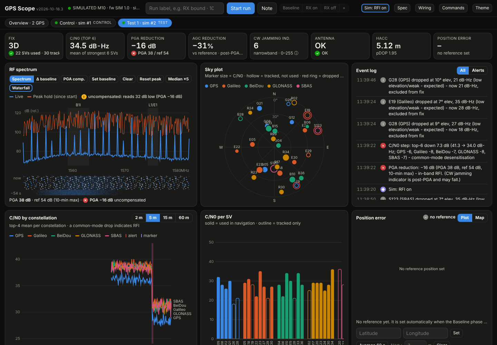
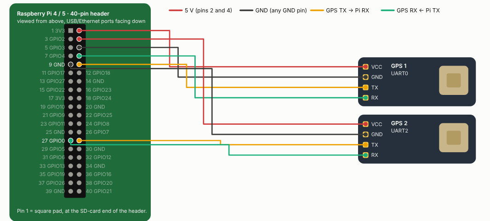

# GPS Scope




A tool for finding out whether an ELRS receiver (or VTX, camera, ESCs…) is degrading a u-blox M8 or M10 GPS. It reads the GPS's own diagnostics (spectrum, front-end gain, per-satellite signal) and shows them in a live web dashboard.

**Two ways to use it:**

| | Quick check: laptop + FC | In-depth testing: Raspberry Pi |
|---|---|---|
| Hardware | Windows laptop, USB cable to the quad | Raspberry Pi wired to one or more GPS modules |
| GPS | the one already in your quad, via Betaflight/INAV passthrough | bare GPS modules on the bench or in the field |
| Good for | "is my build affected?", A/B-ing receivers or settings in the real quad | controlled experiments: several GPS at once with a control receiver, distances, shielding, long or unattended runs |
| Electrical setup | laptop and quad share USB ground; the laptop itself is an RF source nearby | the receiver under test is powered on its own supply, nothing connected to it, and the Pi can sit away from it on Wi-Fi or its own hotspot. The only path to the GPS is radiated, which isolates the effect you're measuring |
| Start | [Quick start](#quick-start-windows-laptop--flight-controller) | [Raspberry Pi setup](#raspberry-pi-setup) |

Both give the same dashboard and logs:

- **RF spectrum** (M10 only). The receiver's built-in spectrum analyser covers about 1520–1650 MHz, so you can see GPS L1, Galileo E1, BeiDou B1I and GLONASS L1. It has max-hold, a frozen **baseline** overlay, and a **Δ vs baseline** view.
- **Per-satellite C/N0**, elevation, azimuth, used/not used, and per-signal detail, shown in a sky plot and a bar chart.
- **Per-constellation signal strength over time**, with alerts and your markers drawn on the chart.
- **Receiver front end**: jamming indicator, AGC, noise, PGA gain, and L1 in-band power, each on its own small chart.
- **Position drift**: a reference point is set automatically (median of good fixes). During a run's Baseline phase it follows that phase, updating every 10 s, and it's fixed when the next phase starts, and the UI shows how far the reported fix wanders, with alerts above a threshold. With several GPS, the Overview plots where each one thinks it is and how far apart they are.
- **Events**: satellite losses (unexpected ones above 20° flagged separately), mass dropouts, simultaneous C/N0 dips, jamming state, fix changes and drift.
- **Labelled test runs** logged to CSV, plus a comparison table with Δ against your baseline run.

Every setting is written to the GPS's **RAM only**, so power-cycling it restores whatever your flight controller saved.

## Quick start: Windows laptop + flight controller

GPS Scope runs on Windows 10/11 and monitors the GPS **inside a built quad** through the flight controller's USB port, using Betaflight/INAV GPS passthrough. The GPS stays in its real position with the real receiver, ESCs and VTX around it.

1. Install Python 3 from [python.org](https://www.python.org/downloads/) (tick *Add python.exe to PATH*).
2. Download the **Windows zip** from [Releases](https://github.com/flyingbandit/GPS-Scope/releases) and unzip it.
3. Plug the quad into the laptop by USB and **close Betaflight Configurator** (only one program can use the COM port). Power the quad from a battery if the GPS or receiver isn't powered from USB.
4. Double-click **`start_windows.bat`**. The first run sets up Python packages. It finds the flight controller, switches it to GPS passthrough and opens the dashboard at `http://127.0.0.1:8080`.

Options: `start_windows.bat --fc COM5` names the FC's port; `start_windows.bat --port COM7` uses a GPS on a USB-UART adapter instead. `python gpsscope.py --list-ports` lists the ports.

Notes:
- Passthrough lasts until the FC is power-cycled; unplug it to return to normal. GPS Scope's GPS settings are in RAM only, so the FC's own GPS setup comes back too.
- Through the FC, NAV-SAT and NAV-SIG are sent every 5th fix, so everything fits the FC's GPS UART (57600 or 115200). The GPS's baud is never changed.
- The ELRS receiver keeps sending its own telemetry during passthrough, so receiver interference tests work as normal.
- Automatic passthrough is Betaflight and INAV only. For ArduPilot, see below.
- u-center on the same laptop can watch at the same time on `tcp://127.0.0.1:2101`.
- The laptop and its USB cable are close to the GPS and share the quad's ground, so they are part of what you're measuring. Compare like with like (same cable, same laptop position), or use the Pi rig when you need to rule them out.

### ArduPilot (manual passthrough, untested)

ArduPilot sets up passthrough with parameters rather than a CLI command, so do it by hand:

1. In Mission Planner or QGroundControl, set:
   - `SERIAL_PASS1 = 0` (USB)
   - `SERIAL_PASS2` = the GPS's serial port number (e.g. `3` if the GPS is on SERIAL3)
   - `SERIAL_PASSTIMO = 0`. Otherwise passthrough stops after 15 s without data from the USB side, and GPS Scope rarely writes to the GPS.
   - optionally `GPS_AUTO_CONFIG = 0` while testing, so ArduPilot doesn't reconfigure the GPS's messages
2. Close Mission Planner/QGC so the COM port is free.
3. Run `start_windows.bat --port COM5` (the FC's port).

Afterwards set `SERIAL_PASS2 = -1` and `GPS_AUTO_CONFIG = 1` again. Passthrough doesn't run while armed, and MAVLink over USB is unavailable while it's on.

## Raspberry Pi setup

The Pi rig is the in-depth method: bare GPS modules on the Pi's UARTs, the device under test powered separately, and the Pi reachable over Wi-Fi so nothing else is wired into the setup.

### Wiring (Pi UART)

| GPS | Raspberry Pi |
|---|---|
| TX | GPIO15 / RXD (pin 10) |
| RX | GPIO14 / TXD (pin 8) |
| GND | GND (pin 6) |
| VCC (5 V) | 5 V (pin 2 or 4). Check your board; most drone GPS boards take 5 V. |

The Pi's GPIO is 3.3 V. Drone GPS modules output 3.3 V logic, so they're safe to connect directly. A USB-UART adapter also works; use `GPS_PORT=/dev/ttyUSB0`.

Power the ELRS receiver from a **separate** 5 V supply (a BEC or USB power bank). It only needs power and to be bound to your radio. Don't connect its TX/RX to anything.

### Install

On the Pi (Raspberry Pi OS Bookworm or later):

```bash
git clone https://github.com/flyingbandit/GPS-Scope.git gpsscope
cd gpsscope && bash install.sh
sudo reboot
```

Or download the **Pi tar.gz** from [Releases](https://github.com/flyingbandit/GPS-Scope/releases) and run `tar xzf GPS-Scope-*-pi.tar.gz && cd gpsscope && bash install.sh`, or copy the folder over from a PC with `scp -r gpsscope pi@raspberrypi.local:~` and run `install.sh` as above. Use your Pi's own user and hostname throughout.

Then open `http://raspberrypi.local:8080`. The installer sets GPS Scope up as a service, so it starts on every boot.

**Updating from a Windows PC:** `powershell -ExecutionPolicy Bypass -File .\update.ps1 -Pi pi@raspberrypi.local` copies the files, restarts the service and prints the running version. Put `user@host` in `pi-target.txt` next to the script to make that the default. The **Commands** panel in the UI lists the other handy one-liners, already filled in with your Pi's address.

**In the field with no Wi-Fi**, make the Pi start its own hotspot at every boot. Run this once on the Pi:

```bash
cd ~/gpsscope && bash netsetup.sh
```

Join the **GPSScope** network (password `gpsscope123`, or reuses a hotspot you already made) and open `http://10.42.0.1:8080`. Map tiles won't load without internet, but everything else works, including the drift plot.

**Ethernet works alongside the hotspot.** Plug the Pi into your router and open `http://<hostname>.local:8080` from your home network. The **Network** button then shows both links and can switch **Wi-Fi off until the next reboot**. That's worth doing for 2.4 GHz ELRS tests: the Pi's Wi-Fi shares the band with ELRS 2.4, so the dashboard link can drop out, and it's one less transmitter next to the GPS. The switch refuses if you're connected over Wi-Fi, so you can't lock yourself out, and the hotspot comes back on every boot.

Options: `HOTSPOT_SSID=… HOTSPOT_PASS=…` for a new hotspot's name and password; `HOTSPOT_BAND=a WIFI_COUNTRY=GB` (your country code) for a 5 GHz hotspot on a Pi 3B+/4/5, away from ELRS 2.4. Undo with `sudo systemctl disable --now gpsscope-net; sudo rm /etc/sudoers.d/gpsscope-net`.

**Try it without hardware:** `python3 gpsscope.py --sim`. Use the *Sim: interference* button in the header to toggle a fake noisy receiver.

### Test procedure

1. Put the GPS outside with a clear sky, on something non-metallic, and leave it alone for **at least 5 minutes** so the satellite set and accuracy settle.
2. **Reference position:** nothing to do. The Baseline phase of each run sets it. *Use 60 s average* sets it straight away if you want it before a run.
3. With the ELRS RX unpowered, start a run labelled *Baseline* and press **Capture baseline** on the spectrum. Record about 2 minutes.
4. Change **one thing**, start a new run, and record 2 minutes. Repeat for each condition, for example:
   - RX powered but unbound, then bound with telemetry 1:2, then telemetry off
   - RX at max power, and in WiFi mode (older ELRS starts WiFi about 60 s after boot if it isn't bound)
   - RX at 2, 5, 10 and 15 cm, and above or below the GPS
   - Copper tape or shielding, then VTX on, then the full quad armed
5. Go back to the baseline at the end. If it doesn't match the first baseline, the sky changed under you and the comparison is less reliable.

Satellites move, so compare runs taken close together, and only trust differences bigger than about 1–2 dB.

## Several GPS at once



| GPS | GPS TX → Pi RX | GPS RX ← Pi TX | 5 V | GND | Pi 4 `config.txt` | Pi 5 `config.txt` |
|---|---|---|---|---|---|---|
| 1 | pin 10 (GPIO15) | pin 8 (GPIO14) | pin 2 | pin 6 | on by default | on by default |
| 2 | pin 28 (GPIO1) | pin 27 (GPIO0) | pin 4 | pin 9 | `dtoverlay=uart2` | `dtoverlay=uart1-pi5` |
| 3 | pin 29 (GPIO5) | pin 7 (GPIO4) | shared | pin 14 | `dtoverlay=uart3` | `dtoverlay=uart2-pi5` |
| 4 | pin 21 (GPIO9) | pin 24 (GPIO8) | shared | pin 20 | `dtoverlay=uart4` | `dtoverlay=uart3-pi5` |
| 5 | pin 33 (GPIO13) | pin 32 (GPIO12) | shared | pin 25 | `dtoverlay=uart5` | `dtoverlay=uart4-pi5` |

The header has only two 5 V pins, so from 3 GPS up join the extra 5 V leads (or use a separate 5 V supply with its GND joined to the Pi's). `GPS_UARTS=N bash install.sh` adds the `dtoverlay` lines. The dashboard's **Wiring → Several GPS** draws the same for 2–5 GPS.


GPS Scope finds every u-blox receiver on its own:
- the Pi's GPIO UARTs (`/dev/serial0` and `/dev/ttyAMA*`)
- USB-UART adapters (`/dev/ttyUSB*`, `/dev/ttyACM*`)
- anything you plug in while it's running.

It finds them by **listening only**. It holds the DTR/RTS lines low so ESP32 boards don't reset, never opens the Bluetooth UART, and never writes to a port unless it has already heard a GPS on it. To keep it away from a port entirely, use `--exclude /dev/ttyACM0` or `GPS_SCAN_EXCLUDE=...`.

- **More GPIO UARTs (Pi 4 / Pi 5):** `GPS_UARTS=5 bash install.sh`, then reboot. **Wiring → Several GPS** shows the pin for each UART. Pi 3 / Zero 2 W have only one reliable GPIO UART, so add more GPS through USB-UART adapters. Use a **powered** USB hub beyond a few units.
- **Spec per port:** click **Spec** (or **Edit spec** in Overview) for each GPS. Fill in the product, antenna, mounting, distance from the RX and notes, plus the **role**:
  - **Control:** well away from the RX
  - **Test:** near the RX
  - **Ignore**
  
  The spec belongs to the physical port: the GPIO UART, or a USB socket via `/dev/serial/by-path`. It's stamped into every run (`receiver.json`). If a GPS with a different chip ID turns up on a port, you get a warning to check that port's spec.
- **One run, all receivers:** Start/Stop and the phase buttons apply to every receiver at once. A run folder now holds one subfolder per receiver plus `run.json`.
- **Overview tab:** a card for each receiver, and Top-6 C/N0, gain cut and movement for every receiver on shared charts. The **Receiver comparison** shows each receiver's change from its own baseline, and **vs control**: that change minus the control receiver's change in the same phase. Because they all see the same sky at the same moment, the vs-control figure removes satellite movement and weather. What's left is the effect at that receiver's position.
- Try it without hardware: `python3 gpsscope.py --sim --sim-count 4` (receiver 1 is a control).

Each receiver runs at 10 Hz, so a Pi 4 or 5 comfortably handles several. On a Pi 3, expect about 3.

## Constellation presets (M10)

**Spec → Set constellations** sends a setup suited to drones and planes to a u-blox M10 (directly, or through the FC in passthrough):

| Preset | Systems | Fix rate |
|---|---|---|
| **UK drone / plane** (recommended) | GPS + Galileo + GLONASS, SBAS limited to EGNOS, QZSS off | 5 Hz (M10 limit for this mix: 6 Hz) |
| **UK drone / plane, most satellites** | + BeiDou B1C | 4 Hz (M10 limit for four systems) |
| u-blox factory | GPS + Galileo + BeiDou B1I, QZSS, SBAS | 1 Hz |

Next to it, **platform** sets u-blox's dynamic model: *Airborne <1 g* (planes, gentle flying), *Airborne <2 g* (default, most quads), *Airborne <4 g* (racing/aerobatic), or *Portable* (u-blox's bench default). The M10 tracks up to four systems at once; BeiDou B1I can't run alongside GLONASS, so the four-system preset uses B1C. GLONASS's orbits favour high latitudes like the UK; QZSS only covers Asia-Pacific.

By default the change is RAM-only and is gone at the next power-off. Tick *Try to keep after power-off* to also save it to the GPS's backup RAM and flash. Most drone M10 modules have no flash, so it then lasts only while the module's backup battery or supercap holds. A flight controller may also set its own constellations, rate and model at boot, so set them in the FC's GPS settings as well. The GPS restarts tracking when you send a preset, so expect a few seconds of lower C/N0 (logged as an event).

## Live view in u-center

Each GPS also streams its raw UBX data on a TCP port while GPS Scope keeps logging: GPS1 on **2101**, GPS2 on **2102**, and so on. The port is shown on each receiver card. In **u-center 2**, add a TCP data source (Ctrl+T) and enter `tcp://raspberrypi:2101`: use the Pi's bare hostname or its IP address, because u-center 2 can't look up `.local` names. In u-center classic it's *Receiver → Connection → Network connection*. The relay is **read-only** for settings: u-center's queries (MON-VER, polls, CFG-VALGET) reach the GPS so it can identify the receiver, but anything that would change it, such as CFG-VALSET, saving config or a reset, is discarded. Start GPS Scope with `--ubx-tcp-write` if you want u-center to configure it, or `--ubx-tcp 0` to turn the relay off.

To check what a relay port is sending, run `python3 ubxpeek.py 2101` on the Pi: it counts each UBX message type for 5 seconds.

Every run also saves `raw.ubx` in each receiver's folder: the GPS's own byte stream for the whole run. u-center opens it with *File → Open* and can play it back, so anyone can step through a run in u-center's own panes. `raw.ubx` holds real positions, so it is left out of the **Share** export.

## Phases and run analysis

During a run, press **Baseline**, **RX on** or **RX off** in the header at the moment you make the change. The **+** button adds a custom phase, such as "RX 15 cm" or "Telemetry off". The **Run analysis** panel splits the run at those marks. **Analyse** in the run table does the same for a finished run, including older runs, where markers are used as phase boundaries.

The rules it follows keep the data unbiased:
- **The phases are yours.** They are never guessed from the data. What the data *detected*, such as a gain cut or a spike burst starting or ending, is listed separately. You get a warning if it happened well before or after your mark, because that phase then contains data belonging to its neighbour.
- **Values are medians with their IQR and sample count.** Nothing is trimmed. Phases shorter than 60 s are flagged as "short".
- **Paired C/N0 change** compares each satellite only with itself, using satellites tracked in both phases. Satellites rising or setting can't skew it. Baseline satellites that disappear are counted separately as "lost".
- **Movement** is measured from the mean of that run's own baseline-phase fixes, so it doesn't depend on the drift reference point. "GPS over-confident" is the share of fixes where the real movement was more than 2× the GPS's own hAcc.
- **Recovery after an "off" phase** is the time until satellites used are ≥ baseline − 1, top-6 C/N0 is ≥ baseline − 1 dB, PGA is ≥ baseline − 1 dB, and position error is ≤ max(1 m, 2× the baseline p95), all held for 10 s. If that never happens, it reports "not recovered within N s" rather than a time.

From the command line: `python3 analyse_run.py runs/<run folder>` prints the same report and writes `analysis.json`.

Suggested run shape: **≥ 60 s Baseline → ≥ 60 s RX on → ≥ 120 s RX off**.

## Reading the results

| You see | It means |
|---|---|
| C/N0 drops by the **same few dB on every constellation at once** (a *mass dip* alert) | Broadband noise is reaching the antenna. This is the classic signature of a noisy receiver. |
| One satellite drops at low elevation | Normal sky geometry. Logged as info only. |
| Satellites above 20° lost while strong | Unexpected. Check the Events log and sky plot for direction. |
| **Gain cut** tile/chart rises (PGA below baseline; on M8, AGC drop) | The receiver is turning its own gain down because strong energy is arriving in band. This is the most reliable sign of a noisy ELRS receiver, and it raises an alert at 3 dB. |
| **What "baseline" means for the gain cut** | The median PGA over the run's **Baseline** phase (or a manual *Capture baseline*). Before you have one, it's the highest steady PGA since the GPS connected, ignoring the first 60 s while the front end settles. It never quietly expires, so long-running interference can't become the new normal. *Clear baseline* restarts it, and plugging in a different GPS clears it. |
| **CW jamming indicator falls** while things get worse | Expected. It only detects single-tone (narrowband) jammers and is measured after the gain stage, so broadband noise drags it down. Don't use it on its own. |
| **PGA gain drops versus baseline** | The receiver turned its own gain down because something strong is in band. The spectrum trace then sits lower overall, so the Δ view **understates** the problem. Watch the PGA tile. |
| Narrow spikes on the spectrum | A spur from a clock or harmonic, e.g. a digital line or oscillator. Hover to read the frequency. |
| A raised floor across the whole band | Broadband noise, e.g. power-supply switching or digital noise. |
| Drift grows while hAcc stays small | The receiver is confidently wrong. This is the drone equivalent of poshold wander or toilet-bowling. |

The M8 has no spectrum analyser. It still reports the jamming indicator, AGC and noise, which are enough to A/B test.

## Notes

- Spectrum values are relative dB, measured *after* the receiver's PGA (programmable gain amplifier), on the same scale u-center shows (MON-SPAN bytes are quarter-dB). They're good for comparing like-for-like, not absolute power. That's why the PGA value is always shown and logged. Runs recorded before v2026-10-18.10 stored the raw bytes, so their `spectrum.csv` and L1-power numbers are 4× larger; `analyse_run.py` detects and converts them.
- An **always-on log** is written to `runs/_continuous/YYYYMMDD_timeline.csv` and `_events.csv` whether or not a run is active. Download it with **Download continuous log** in the run table.
- Spectrum **PGA comp.** is off by default, so the trace is exactly what the receiver reports. Turned on, it adds back the gain the receiver removed (about 0.5 dB of spectrum per PGA dB, measured on a real M10) as an estimate of the energy arriving. Once the PGA reaches its minimum the front end is saturated and the estimate is unreliable; the page says so. The PGA reduction tile is the reliable measure of how hard the receiver is being hit.
- Logs are saved in `runs/<timestamp>_<label>/`: `sats.csv`, `rf.csv`, `pvt.csv`, `spectrum.csv`, `timeline.csv`, `events.csv` and `summary.json`. The UI's **CSV** button zips a run for download.
- **Sharing a run:** the **Share** button in the run table, or `python3 share.py runs/<run folder>`, makes a copy that is safe to post. It has no latitude, longitude or altitude: position is kept as metres from each receiver's own baseline average. Times become seconds from the start of the run. Satellites get random names, azimuth is removed and elevation is rounded to 10°. The chip serial, the drift reference point and the spec's location and notes fields are also removed. GPS model, firmware, product and every RF figure stay in, and `analyse_run.py` works on the shared copy. The **CSV** button still gives the full log.
- Command-line options: `--port`, `--baud` (default: auto-detect), `--set-baud 115200`, `--keep-nmea`, `--http 0.0.0.0:8080`, `--logdir`.

## Files

| File | What it does |
|---|---|
| `gpsscope.py` | The logger and web server. Talks UBX to each GPS, writes runs, serves the UI. |
| `static/index.html` | The whole web UI, in one file. |
| `analysis.py` | Phase analysis used by the UI and the CLI. |
| `analyse_run.py` | Re-analyse a recorded run from the command line. |
| `share.py` | Makes the anonymised **Share** copy of a run. |
| `ubxpeek.py` | Counts the UBX messages on a u-center relay port. |
| `install.sh` | Pi installer: packages, UARTs, systemd service. |
| `netsetup.sh` | Optional Pi network setup: hotspot at every boot, Ethernet alongside, Wi-Fi switch in the dashboard. |
| `update.ps1` | Push an update from a Windows PC to the Pi. |
| `start_windows.bat` | Run GPS Scope on a Windows laptop, via FC passthrough or a USB-UART GPS. |

## Contributing

Issues and pull requests are welcome, especially logs from other GPS modules or RF sources. Please post the **Share** export rather than a raw run folder: raw runs, and `raw.ubx` in particular, contain your exact position.

## Licence

MIT. See [LICENSE](LICENSE).
